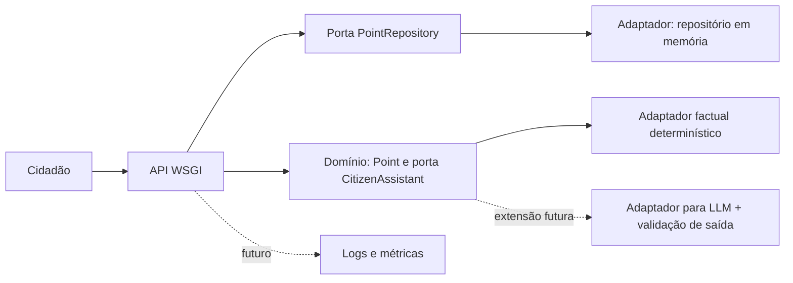

# Arquitetura - CitizenTech Mobilidade

## Componentes e fluxo

As linhas pontilhadas são propostas para produção. No slice não há LLM nem telemetria de latência implementados; somente erros recebem `traceId`.

O domínio só conhece as portas `PointRepository` e `CitizenAssistant`; não importa SDK, biblioteca ou chave de LLM. Para trocar o modelo, troca-se o adaptador selecionado na composição da aplicação, mantendo domínio, endpoints e testes intactos.

## Fronteiras

| Camada | Responsabilidade | Não pode conhecer |
|---|---|---|
| `src/domain` | regras e contratos (ports) | HTTP, SDK de LLM e persistência concreta |
| `src/infra` | adaptadores de dados e IA | regras de rota HTTP |
| `src/api` | tradução HTTP, validação e códigos de erro | detalhes internos do modelo |

## ADR-001 - Adaptador próprio para IA

**Contexto:** o serviço precisa oferecer orientação por IA sem acoplar o domínio a um fornecedor.

**Opções:** (1) chamar SDK do LLM dentro do endpoint; (2) LangChain no domínio; (3) criar a porta `CitizenAssistant` e adaptadores na infraestrutura.

**Decisão:** opção 3.

**Consequência:** há uma pequena interface extra, mas testes usam fake determinístico e a troca entre Ollama, API externa ou regra local é localizada. Não usar LangChain reduz dependência para este slice.

## ADR-002 - Resposta factual sem RAG neste slice

**Contexto:** o assistente só pode orientar com dados confiáveis de ponto e linha.

**Opções:** (1) prompt aberto; (2) RAG com documentos municipais; (3) adaptador que recebe somente o `Point` já validado pelo domínio.

**Decisão:** opção 3 no slice; RAG entra futuramente como adaptador que devolve evidências verificáveis.

**Consequência:** não há previsão de chegada nem resposta sobre fatos não cadastrados. Isso reduz utilidade inicial, mas evita alucinação e mantém o comportamento testável.

## Extensão de IA

Uma futura implementação `OllamaAssistantAdapter` ou `ExternalLlmAssistantAdapter` em `src/infra/assistant_adapter.py` implementará `answer(point, question)`. Hoje a troca ocorre em uma linha na composição de `create_app`, substituindo `FactOnlyAssistantAdapter()`; seleção por variável de ambiente ainda não foi implementada. O adaptador atual é determinístico e não chama LLM real.

## ADR-003 - Dados de demonstração em memória

**Contexto:** o slice deve ser reproduzível sem depender de credenciais ou dados externos de transporte.

**Opções:** (1) consultar uma API municipal real; (2) usar banco de dados local; (3) fornecer dados fictícios em memória atrás da porta `PointRepository`.

**Decisão:** opção 3 para demonstração e testes.

**Consequência:** execução simples e determinística, mas pontos e linhas não representam o transporte real. Antes de produção é necessário criar um adaptador para uma fonte oficial e monitorar sua atualização.

## Observabilidade e segurança

Os itens abaixo são requisitos propostos para produção, não instrumentação já implementada no slice.

- Logar `traceId`, rota, HTTP status e latência; nunca a pergunta completa nem dados pessoais.
- Monitorar p95 de latência, taxa 5xx, taxa de recusa/503, tokens e custo quando houver LLM externo.
- Alertar se p95 exceder 500 ms por cinco minutos, 5xx exceder 2% por cinco minutos ou a base estiver há mais de 24h sem atualização.
- Validar `limit`, `offset`, JSON e campos obrigatórios na API; limitar pergunta a 300 caracteres antes de encaminhá-la ao adaptador. Essas validações já existem no slice.
- Segredos ficam em variável de ambiente/configuração do ambiente, nunca em código, log ou repositório.
