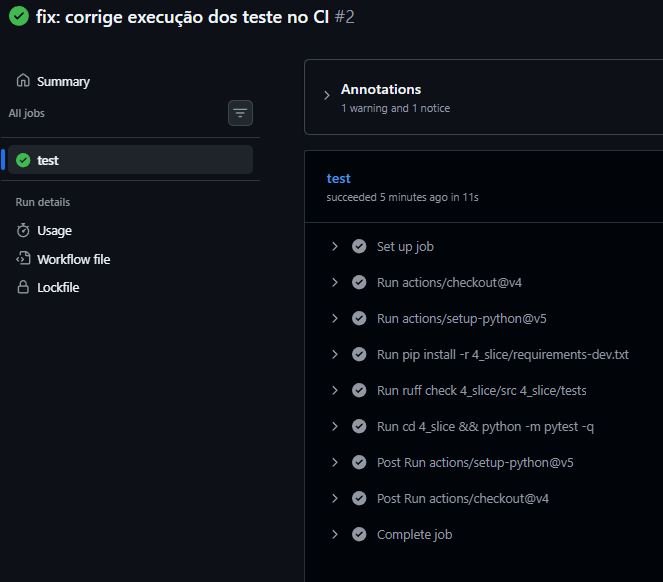

# GS 2026.2 - CitizenTech Mobilidade

Projeto da turma **2CCPY-2026**, modalidade trio. Integrantes: **Henrique Boscoli - RM 563651**, **Joao Henrique - RM 563578** e **Tomazzo Canterucci - RM 565566**.

## Índice

1. [Visão de produto](1_visao_produto.md)
2. [Contrato OpenAPI](2_contrato_api.yaml)
3. [Arquitetura e ADRs](3_arquitetura.md)
4. [Evals e guardrails](5_evals_de_ia.md)
5. Slice executável: `4_slice/`

## Rastreabilidade dos testes

| Requisito | Evidência no slice |
|---|---|
| RF-02: consultar ponto | `test_get_existing_point_returns_contract_shape` |
| RF-01: listagem paginada | `test_list_points_honors_pagination` |
| RF-05: ponto inexistente | `test_missing_point_returns_404_error_shape` |
| RF-04: orientação com fatos conhecidos | `test_ask_returns_only_known_facts` |
| Alternativa para ponto em manutenção | `test_unavailable_point_suggests_known_alternative` |
| Resposta de ponto contra o schema OpenAPI | `test_point_response_matches_openapi_schema` |
| Pergunta acima de 300 caracteres | `test_question_longer_than_contract_limit_is_rejected` |
| Falha do assistente | `test_ask_uses_fake_unavailable_adapter_without_real_llm` |

Os dados do repositório são fictícios. Latência, disponibilidade, cobertura e alertas são metas de produção, não medições já comprovadas. O adaptador atual é determinístico e não chama um modelo de IA real.

## Executar e testar

Pré-requisito: Python 3.11+.

```powershell
cd 4_slice
python -m pip install -r requirements-dev.txt
python -m pytest -q
python -m src.api.app
```

Em outro terminal, uma requisição real:

```powershell
Invoke-RestMethod http://localhost:8000/points/P001
```

Resposta esperada: o ponto `P001`, com `status` `AVAILABLE` e linhas `101` e `205`.

Para demonstrar uma alternativa cadastrada, consulte também `http://localhost:8000/points/P002`: o status é `MAINTENANCE` e `alternativePointId` é `P001`. Esses dados são fictícios; não há cálculo de proximidade.

## Validar o contrato

```powershell
python -m pip install openapi-spec-validator
python -m openapi_spec_validator ..\2_contrato_api.yaml
```

O OpenAPI foi escrito antes do slice. Um teste valida as respostas de `GET /points/{pointId}` contra o schema `Point` do próprio YAML; outro verifica o erro 404. A resposta 503 da consulta de ponto está prevista para uma futura fonte externa e não é simulada pelo repositório em memória.

## CI e evidência

O workflow em `.github/workflows/ci.yml` instala as dependências, executa o lint e os testes. A cópia em `4_slice/.github/workflows/ci.yml` compõe o entregável e considera a pasta do projeto como raiz do repositório. A cobertura de 70% é uma meta futura e ainda não é medida no CI.

Repositório: [gs-citizentech-mobilidade](https://github.com/Boscolii/gs-citizentech-mobilidade). A captura abaixo registra a execução CI #2 aprovada no commit `b220898`.


As etapas de lint e testes concluídas na mesma execução:



## Vídeo (até 3 minutos)

1. Cada integrante se apresenta; 2. mostrar a visão/contrato; 3. executar `python -m pytest -q`; 4. consultar `GET /points/P001` e `GET /points/P002`; 5. explicar a porta `CitizenAssistant`, o fake e o CI.
